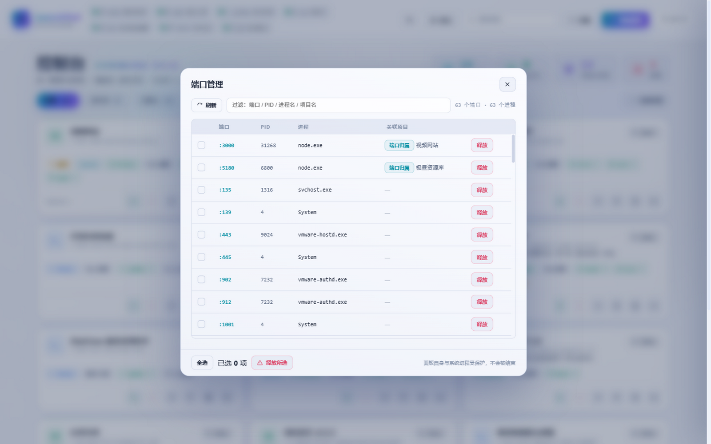

# LaunchPad · 项目启动面板

> 本地项目的统一启动台：自动扫描、分析启动方式、一键启停、实时状态与日志、端口管理。
>
> 零依赖 · 纯 Node.js 后端 · 原生前端 · 无构建步骤 · Windows / macOS

<div align="center">
  
</div>

---

## 功能特性

| 功能 | 说明 |
| --- | --- |
| 🔍 自动扫描 | 扫描项目根目录（支持多层嵌套），识别 `package.json` / `requirements.txt` / `pom.xml` / `index.html` 等清单文件，自动注册项目 |
| 🧠 启动方式分析 | 自动推断启动命令、识别框架（Next.js / Vite / Express / FastAPI / Django / Maven / 静态站…）与端口（含 `run.bat`、源码嗅探） |
| ▶️ 一键启停 | 启动 / 停止 / 重启，进程树级终止；面板重启后自动接管仍在运行的项目；运行中项目的「停止」按钮高亮为实心红，一眼可点 |
| 🎨 按钮语义色 | 全站统一：启动=绿（抽屉内为实心绿主按钮，运行中转幽灵绿）、停止/移除=玫瑰、重启=蓝、置顶=琥珀，日志/目录保持中性灰；深浅两主题分别校准 |
| ⌘K 命令面板 | `Ctrl+K` 全局呼出：模糊搜索项目直达详情、行内直接启动/停止，以及扫描 / 添加 / 端口管理 / 批量管理 / 切换主题等全局命令 |
| 🃏 卡片 / 列表双视图 | 卡片网格与紧凑列表两种密度，筛选行右侧切换并本地记忆偏好 |
| 🖱️ 右键菜单 | 卡片上右键直达：详情 / 启动 / 停止 / 重启（随状态禁用）/ 打开端口页 / 打开目录 / 复制路径 / 置顶；视口边缘自动内收 |
| 🕐 运行履历 | 持久记录累计运行次数与最近启动时间；停止的卡片显示「上次运行 x 前」，详情抽屉展示累计次数 |
| 💡 徽标点亮 | 类型徽标如仪器指示灯：待机=灰暗、运行中=点亮技术栈类型色、异常=玫瑰点亮，状态一眼可辨 |
| 🏷️ 状态 favicon | 浏览器标签页图标随全局状态变色：异常=玫瑰 · 有运行=绿 · 空闲=品牌靛蓝 |
| 📋 粘贴即添加 | 在页面空白处直接 `Ctrl+V` Windows 路径（资源管理器复制目录即可），自动打开「添加项目」并填入 |
| ⌨️ 快捷键体系 | `Ctrl+K` 命令面板 · `/` 搜索 · `1-4` 快速筛选 · `G` 切换卡片/列表视图 · `Esc` 逐层关闭；筛选偏好本地记忆 |
| ⇧ 范围勾选 | 批量模式下按住 `Shift` 点击 = 从上次勾选锚点到当前项的范围选择 |
| 🌗 主题柔和过渡 | 深浅切换 450ms 全局色彩渐变，不再瞬间跳变；尊重系统「减少动态效果」设置（CSS + Canvas 均静止） |
| ⏳ 长运行提示 | 项目连续运行 ≥24 小时，卡片运行时长变琥珀色提醒 |
| ❓ 操作指南 | 右上角 `?` 按钮 / `?` 快捷键 / 命令面板「操作指南」打开：鼠标操作 / 键盘快捷键 / 实用技巧三区速查；首次访问自动展示一次 |
| 🌓 圆形主题过渡 | 深浅切换从右上角主题按钮处圆形展开（View Transitions API），不支持的浏览器退回全局柔和渐变 |
| 📊 仪表统计条 | 连体统计条带（项目 / 运行中 / 可访问 / 异常，点击直达筛选或端口面板）+ 底部运行状态比例条 |
| 📡 实时状态 | SSE 推送状态变更，端口健康检查（就绪后可直接点击端口打开），运行时长实时跳动；运行中卡片呼吸光晕 + 顶部生命条流光 |
| 🖥️ 日志终端 | 每个项目独立日志流（时间戳 / stdout / stderr 着色、自动滚动） |
| 🌍 环境检测 | 显示每个项目需要的运行环境（Node ≥ 版本、Python、Java、Maven…）并与本机版本比对；缺依赖一键安装 |
| ☑️ 批量管理 | 勾选多个项目，批量 启动 / 停止 / 重启 / 移除 |
| 📌 置顶 | 常用项目置顶显示在分区最前 |
| 🕳️ 移除记忆 | 被移除的项目不会再被「扫描」自动加回，手动添加可恢复 |
| 🔌 端口管理 | 独立面板查看系统全部端口占用，支持单个/批量释放；启动时端口冲突自动预警 |
| ⚠️ 端口冲突警示 | 项目未运行但配置端口被其他进程占用时，卡片显示琥珀色警示标签（含占用进程名 / PID），点击直达详情查看并一键释放 |
| ⏻ 关闭启动器 | 页面右下角圆形关闭按钮：长按 1.5 秒（进度环填满）关闭启动器面板自身，松手过早会浮现操作提示；运行中的项目不受影响，下次启动面板自动接管 |
| ✏️ 名称与简介 | 自动从 README / package.json 提取展示名与一句话简介，支持手动编辑覆盖 |
| 🌗 浅色 / 深色 | 双主题，本地记忆偏好；时段问候语 + 日期、加载骨架屏、SVG 空状态插画、背景流星 |
| 🔎 搜索与整理 | 搜索关键词在标题/简介/路径中高亮，无结果一键清除筛选；「运行中 / 项目库」分区可点击折叠；路径点击即复制；标签页标题实时显示运行数；SSE 断线顶栏提示重连 |

## 界面预览

**端口管理面板** — 项目相关端口置顶标注，可筛选、勾选、批量释放：

<div align="center">
  
</div>

## 快速开始

### Windows

**环境要求**：Windows 10+，[Node.js](https://nodejs.org) ≥ 18（无需 npm install）

| 方式 | 说明 |
| --- | --- |
| 桌面快捷方式 | 运行 `node tools/make-shortcut.js` 一次性生成桌面图标「LaunchPad 项目启动面板」，双击即用 |
| 双击 `start.bat` | 启动最小化服务窗口并自动打开浏览器；面板已在运行时只打开浏览器，不会重复启动 |
| 命令行 | `node server.js` |

- 默认地址 [http://127.0.0.1:7788](http://127.0.0.1:7788)（端口被占用时自动 +1，实际地址写入 `data/panel-url.txt`）
- 停止面板：关闭最小化的 "LaunchPad-Server" 窗口，或结束对应 node 进程

### macOS

**环境要求**：macOS 12+，[Node.js](https://nodejs.org) ≥ 18（Homebrew / nvm / 官方安装包均可，脚本会自动探测 PATH）

项目从 Windows 拷贝到 Mac 后，先执行一次（NTFS 不保存可执行位）：

```sh
chmod +x start.command start.sh stop.sh
```

| 方式 | 说明 |
| --- | --- |
| 双击 `start.command` | 打开终端前台运行，日志滚动显示；`Ctrl+C` 或关闭窗口即停止面板，运行中的项目不受影响，下次启动自动接管 |
| `sh start.sh` | 后台常驻（`nohup`），日志写入 `data/panel.log`；面板已在运行时只打开浏览器，不会重复启动 |
| `sh stop.sh` | 停止后台实例（仅停止面板自身，项目进程继续运行） |
| 命令行 | `node server.js` |

- 默认地址同为 [http://127.0.0.1:7788](http://127.0.0.1:7788)，被占用自动 +1
- 首次启动若 `data/projects.json` 不存在，会以用户主目录（`~`）作为项目根目录，可在「添加项目」弹窗中修改

### Linux

`sh start.sh` 后台启动 / `node server.js` 前台启动均可，打开目录与浏览器依赖 `xdg-open`。

## 使用指南

### 项目卡片

每张卡片展示：类型徽标（按技术栈着色）、项目名与简介、状态（启动中 / 运行中·已就绪 / 已停止 / 异常退出）、环境检查、操作按钮（启动 / 停止 / 重启 / 置顶 / 日志 / 打开目录）。运行中的项目自动归入「运行中」分区，置顶项目排所在分区最前。

### 详情抽屉

点击卡片打开右侧抽屉：概览（状态 / PID / 端口 / 运行时长）、**端口占用查询与释放**、启动配置（名称 / 简介 / 命令 / 工作目录 / 端口，均可编辑）、运行环境比对、实时日志终端。

### 添加项目的三种方式

1. **自动扫描** — 把项目放进根目录，点右上角「扫描」；
2. **手动路径** — 「添加项目」→ 输入项目绝对路径 →「分析并添加」；
3. **手动配置** — 未能自动识别启动命令的项目，打开详情抽屉手填命令并保存。

根目录可在「添加项目」弹窗顶部修改（保存后立即扫描新目录）；已注册的项目不受切换影响。

### 命令面板 / 双视图 / 快捷键

- `Ctrl+K`（或点击搜索框右侧 `Ctrl K` 徽标）呼出命令面板：输入即筛选项目，`↑↓` 选择、`↵` 打开详情，行内按钮可不经详情直接启动/停止；也可执行扫描、添加、端口管理、批量管理、切换主题等全局命令。
- 筛选行右侧可在 **卡片视图 / 列表视图** 间切换，偏好本地记忆。
- `/` 聚焦搜索，`Esc` 自上而下关闭（搜索词 → 命令面板 → 弹窗 → 抽屉）；首屏加载有骨架屏过渡。

### 批量管理 / 置顶

点「批量管理」进入选择模式（点击勾选框或卡片任意处即可勾选），底部浮动操作栏批量操作；卡片上的图钉按钮可将常用项目置顶。

### 端口管理

顶栏「端口」打开独立面板：列出系统全部 TCP 监听端口与占用进程（项目相关端口置顶标注归属），支持筛选、勾选、单个/批量释放。启动项目时若端口已被占用，日志中会立即预警，可直接跳到详情释放。

> ⚠️ 面板自身进程与 PID 0/4 受保护不可结束；释放系统服务（svchost 等）可能影响系统，请确认后再操作。

### 主题

顶栏 ☀ / 🌙 按钮切换浅色 / 深色模式，偏好本地记忆。

## 配置

所有配置持久化在 `data/projects.json`，主要字段：

| 字段 | 说明 |
| --- | --- |
| `baseDir` | 项目根目录，扫描的起点（可在「添加项目」弹窗中修改） |
| `projects[]` | 项目列表（`id` / `name` / `title` / `desc` / `root` / `type` / `runCmd` / `runCwd` / `port` / `pinned` / `requiredEnv` / `meta`…） |
| `removedRoots[]` | 被移除项目的路径名单，扫描时跳过 |
| `lastScanAt` | 上次扫描时间 |
| `port` | 面板端口（默认 7788，可用环境变量 `PANEL_PORT` 覆盖） |

手动编辑该文件后重启面板即可生效；删除它则恢复出厂（自动重新扫描）。

## 常见问题

**启动后立刻「异常退出」？**
打开项目日志查看：最常见原因是端口被占用（日志会有 ⚠ 预警，到详情「端口占用」一键释放）或依赖未安装（卡片有「缺依赖」标签，点击安装）。

**项目没有被识别出来？**
确认目录里有 `package.json` / `requirements.txt` / `pom.xml` / `index.html` 之一；都没有的话用「手动路径」强制添加，然后手填启动命令。

**移除的项目被扫描加回来了？**
v1.0.6+ 已有移除记忆，扫描不会加回；旧版本数据可在「添加项目」→ 手动路径重新添加后正常。

**面板端口被别的程序占了？**
自动切换到 7789+，实际地址看 `data/panel-url.txt`，或用环境变量 `PANEL_PORT` 指定固定端口。

**环境检查显示 ✗？**
对应工具链（Node / Python / Java / Maven…）未安装或不在系统 PATH 中，安装并重开面板即可。

## 目录结构

```
project-startup/
├─ server.js            # 后端（零依赖 Node，跨平台）
├─ public/              # 前端（无构建）
│  ├─ index.html
│  ├─ style.css
│  ├─ app.js
│  └─ icons.js          # 内联 Lucide 风格 SVG 图标库
├─ tools/
│  ├─ make-icon.js      # 生成品牌图标 icon.ico
│  └─ make-shortcut.js  # 生成桌面快捷方式
├─ data/                # 运行时配置（自动生成）
│  ├─ projects.json
│  └─ panel-url.txt
├─ docs/                # 截图
├─ icon.ico
├─ start.bat            # Windows 一键启动
├─ start.sh / stop.sh   # macOS / Linux 后台启动与停止
└─ start.command        # macOS 双击启动
```

## 技术实现

- **后端**：纯 Node.js（`http` / `child_process` / `net`），零第三方依赖
- **进程管理**：`spawn(shell:true)` 启动 + 进程树级终止（Windows `taskkill /T /F`；macOS·Linux `detached` 进程组 + `kill(-pid)`，接管 PID 非组长时降级单杀）；重启后按 PID 接管存活项目，并以端口可达性校验防御 PID 复用误判
- **实时推送**：SSE（状态 + 日志），前端渲染签名去重避免无谓重绘
- **端口扫描**：Windows `netstat -ano` / macOS·Linux `lsof -nP -iTCP -sTCP:LISTEN` 解析 LISTENING + 一次性进程名表映射（Windows `tasklist` / macOS·Linux `ps -axo`）
- **跨平台（v1.1.25）**：新增 macOS 启动链——`start.command` 双击前台运行、`start.sh` 后台常驻、`stop.sh` 停止（含 Homebrew / nvm 的 node 路径兜底、panel.pid 记账）；端口查询、进程名表、进程树终止、打开目录与浏览器（`explorer` / `open` / `xdg-open`）、默认项目根目录（Windows `D:\@DevCode\002-project`、macOS·Linux 用户主目录）全部按平台分支；Python 项目支持 `run.sh` 系启动脚本识别；`procAlive` 将 EPERM 视为存活
- **前端**：原生 HTML / CSS / JS —— 玻璃拟态 + 极光背景 Canvas（星尘与低频流星，低亮度不扰眼）、WAAPI 一次性入场动画（含后台标签页冻结兜底）、命令面板、双视图网格、内联 SVG 图标库、浅色/深色双主题
- **设计基调（v1.1.3「静奢」校准）**：全局降饱和、底色提亮、辅助文字提对比；环境动效全部静止化（保留一次性入场与状态脉冲）；卡片去彩色化——类型色仅存于徽标图标与抽屉氛围，健康环境项不再贴牌，运行态用静态柔光与生命线表达
- **无渐变原则（v1.1.4）**：全站清除彩色渐变，品牌色收敛为单一 `--accent` 靛蓝实色（主按钮/Logo/标签页图标）；激活态（筛选 chip、视图切换）改柔和同色着色；抽屉启动键为绿色实色；语义色（绿/玫瑰/蓝/琥珀）承担状态表达
- **精细体验（v1.1.8）**：卡片右键菜单、运行履历持久化（`runCount` / `lastRunAt`）、类型徽标点亮系统、状态化 favicon、弹层背景滚动锁、Toast 点击即关、卡片键盘可达（Tab + Enter/空格）、搜索一键清除、勾选弹跳、SSE 指数退避重连（3s→15s）、卡片光晕 rAF 节流
- **多角度增强（v1.1.9）**：粘贴即添加、Shift 范围勾选、筛选偏好记忆 + `1-4`/`G` 快捷键、主题切换 450ms 柔和过渡、`prefers-reduced-motion` 全局适配、长运行（≥24h）琥珀提示、Toast `role=status`
- **体验修订（v1.1.10）**：Shift 勾选改为按 DOM 视觉顺序（修复分区重排导致的乱序）、主题切换 View Transitions 圆形展开、帮助中心（`?` 呼出 / 首访自动展示一次 / 命令面板可搜）
- **驾驶舱重构（v1.1.11）**：布局重组为「左侧固定驾驶舱（品牌 / 概览统计 / 引擎清单 / 主操作）+ 精简顶栏（搜索焦点 + 时钟）」，窄屏自动降级为顶部横条；Hero 新增 conic 运行环仪表（`@property` 平滑生长）；卡片新增左缘状态轨（绿=运行 / 玫瑰=异常 / 琥珀=端口冲突）；筛选行新增排序（智能 / 名称 / 状态 / 类型）与紧凑密度切换，偏好均持久化；帮助中心与命令面板同步收录新能力。续作修订：侧栏「运行环境」默认折叠（点击标题展开并记忆，折叠时显示已装引擎数徽标）；卡片与抽屉的「启动」主操作统一为描边绿淡底样式（hover 提亮 + 图标微放大），卡片主按钮回归纯图标并固定 34px 宽度；修复主按钮 class 与主内容区 `.main` 冲突导致的样式泄漏
- **加载提速（v1.1.12）**：工具链探测改为后台并行预热（修复 `spawnSync` 未导入导致的 execSync 慢路径回退；8 工具并行 ~1s 完成，不再阻塞面板启动与首屏请求）+ 10 分钟 TTL 自动刷新（新装工具无需重启面板）；静态资源新增 ETag 协商缓存（代码未变时 304 零传输，改动即生效）；入场动画会话级去重（同会话刷新用快速入场，首次访问保留完整仪式感）；`<body>` 开头内联主题脚本消除浅色用户首绘闪变
- **全面检测修复（v1.1.13）**：API 边界冒烟测试 25/25 通过后修复 6 处 bug——① `PATCH /api/projects/:id` 的 `port` 强校验（1-65535 整数或空，防字符串污染配置与端口监控）、`enabled` 布尔化；② 工具链异步探测失败不再把 `null` 写死缓存（原先会永久阻断同步探测兜底）；③ `ports/release` 端口 `0` 绕过校验 → 400；④ 释放端口改为同步 `taskkill` 并按真实退出状态分账（原先一律报告成功）；⑤ HEAD 请求静态文件 404（外层条件漏放行）；⑥ `pickPanelPort` 递归无终止条件（12 个端口全占用时无限循环）
- **仪表集群与航海日志（v1.1.14）**：布局重组——Hero 运行环 + 概览统计迁入左侧驾驶舱组成「仪表集群」（SVG 刻度运行环：60 细刻度 + 12 主刻度、进度弧 dashoffset 平滑生长；2×2 迷你概览格点击直达筛选；状态比例尺收编其下），Hero 精简为单行标题带，首屏内容区上移约 70px；侧栏新增「运行动态」事件流（SSE 状态变迁实时入账 + localStorage 持久化 24 条 / 7 天有效期，starting/stopping 瞬时过渡不入账防刷屏，点击条目直达项目详情）；方向键 ↑↓←→ 在卡片间移动焦点（列数按 offsetLeft 去重推算，跨行列感知，Home/End 跳首尾）；顶栏时钟冒号 1Hz 呼吸；概览语义色仅在非零时点亮（运行=绿 / 可访问=青 / 异常=玫瑰）；帮助中心同步收录新快捷键与技巧
- **日志回填与轨道星空（v1.1.15）**：修复「项目运行中但抽屉日志为空」——抽屉打开时从 `/api/projects/:id/logs` 增量回填历史日志（after 取缓存末行时间戳，与 SSE 时间戳同源天然去重；SSE 重连时自动补拉断线期间错过的行），面板接管前产生的输出无法回溯时给出准确占位提示；背景丰富化——星尘引入青/紫/亮白着色、新增稀疏「衍射亮星」（十字光芒缓慢明灭）、三条屏外圆心的虚线轨道弧与卫星点拖尾（低亮度不扰眼）、第四极光色块，项目成功启动瞬间一颗流星划过背景（点火彩蛋）；帮助中心收录新技巧
- **日志工作台与时段氛围（v1.1.16）**：日志终端精修——行内 URL 自动高亮为可点击链接（新标签打开，尾部标点不并入）、行悬停高亮、自动滚动按钮点亮态、新增「复制全部日志」（带时间戳与流前缀）；搜索升级为空格分词多关键词 AND 匹配（列表/高亮/命令面板同步生效）；密度三档循环（舒适 → 紧凑 → 极简，极简隐藏简介与标签行，偏好持久化 + Toast 反馈）；时段氛围——极光色随清晨（金粉）/ 上午（清爽青蓝）/ 黄昏（琥珀紫玫瑰）/ 深夜微调，每 10 分钟校准；快捷键 R 手动刷新、无弹层时 Esc 退出批量管理；帮助中心同步收录
- **深空动效（v1.1.17）**：背景动效再丰富——① 卫星信号涟漪：轨道卫星极低频发出声纳圈，从发射点扩散渐隐（同时最多 3 圈）；② 火箭发射：批量点火成功时一枚小火箭从底部摇摆爬升（琥珀尾焰粒子 + 舷灯 + 缓缓加速），并每 45-90s 自发一次；③ 地平线辉光：底部大气弧随氛围色与呼吸微调，为星空提供「地面」纵深；④ 轨道系统浅色主题专用色（colL），卫星/拖尾/涟漪在浅色下用深色轨道色；帮助中心收录「深空细节」条目
- **鼠标交互层（v1.1.18）**：① 背景视差——星尘（按星体大小分深度 z=0.4-1.4）/ 极光 / 轨道分层反向随鼠标缓动（lerp 0.05，rAF 统一计算），星空有了纵深；② 光标灯笼——柔和光晕跟随鼠标缓动，像提灯巡视星空；③ 卡片 3D 微倾斜——悬停时 ±2.2° 随光位倾斜（短过渡 .12s 跟手，离开 .4s 回弹），类型徽标与状态签做反向内部视差（--gx/--gy），与既有跟随光晕构成三层深度；④ 点击空白处星尘涟漪彩蛋——非交互区域点击泛起墨色声纳圈 + 6 颗星尘上浮渐隐；⑤ 仅精确指针设备启用倾斜（`hover:hover + pointer:fine`），触屏与 `prefers-reduced-motion` 自动静止；帮助中心鼠标操作段同步收录
- **重启接管重构（v1.1.19）**：修复「面板重启后项目误显已停止但端口仍被占用」——`spawn(shell:true)` 的 child.pid 实为 cmd 包装进程且先于真实服务退出，原按该 PID 判存活导致重启后全部误判。改为三级接管：runtimePid 存活按 PID 接管（9s 宽限校验）；PID 失效但项目端口被运行时进程监听则按端口接管真实服务 PID（链条自愈）；均无则清记录保持停止。健康巡检对接管项目逐 tick 校验进程存活，并修复 adoptDeadline 过期不清除导致宽限判定永久生效的次生 bug；启动即退出的项目若端口仍被监听则升级为端口监控
- **抽屉指挥舱（v1.1.20）**：详情抽屉重构为「头部铭牌 + 仪表条 + 三页签工作台」——① 头部铭牌：类型徽标（运行/异常时类型色点亮）+ 名称 + 状态签 + 路径副行（点击复制）；② 仪表条四格：端口（就绪时点击直达项目地址，被占用转琥珀警示）/ PID / 运行时长（每秒跳动）/ 累计启动；③ 页签：**概览**（运行档案 + 端口占用 + 启动配置 + 运行环境）、**日志**（终端独占全高 + 行过滤输入：命中行琥珀高亮、新行持续跟进、页签行数徽标）、**履历**（累计启动 / 上次运行汇总 + 本项目事件账，本地近 7 天）；页签偏好持久化，抽屉内 `1/2/3` 快捷切换；④ footer 分组重排：主操作（启动/停止/重启）· 分隔线 · 次操作（置顶；安装依赖改为检测到缺失依赖时才显示）· 删除右置；⑤ 面板加宽至 660px、左缘大圆角、遮罩模糊加深、页签滑入动画；浅色主题与 `prefers-reduced-motion` 同步适配；⑥ 修复「安装依赖」footer 按钮从未绑定事件的缺陷（点击无反应），安装后自动切到日志页签查看进度
- **体验完善轮（v1.1.21）**：以使用者动线全量走查后的修补——① 修复页签切换后正文滚动位置残留导致新页签顶部被截断的缺陷（切换时重置 `drawer-body` scrollTop）；② 抽屉打开时 `↑`/`↓` 直接切换上一个/下一个项目（按当前筛选+搜索+排序同款顺序，页签保持不动，边界 toast 提示），免关闭抽屉再点卡片；③ 异常守护：项目异常退出（crashed）立即弹出玫瑰 toast 提醒（含退出码，停留 6s）——手动停止走 stopping→stopped 链路不会误报；toast 组件支持自定义停留时长（进度条同步）；④ 启动 / 重启指令发出后自动切到日志页签看输出；⑤ 日志过滤激活时「复制日志」只复制命中行并提示行数（`copyText` 支持自定义成功文案，避免双 toast）；⑥ 无障碍补全：抽屉与四个模态卡补 `role="dialog"` + `aria-modal`；帮助中心同步收录 ↑↓ 巡览与异常守护条目
- **精密仪表细节系统（v1.1.22）**：主界面风格深化，主题为「仪器感藏在细节里」——① 卡片 HUD 取景框：悬停 / 键盘焦点 / 批量选中时四角浮现 L 形角标（1px×12px，多重渐变绘制），随状态着色（运行=绿 / 异常=玫瑰 / 端口冲突=琥珀 / 选中=紫，默认靛蓝）；② 状态轨生长：悬停时左缘读数轨向上下延展（16px→8px 缩进，滑轨点亮隐喻）；③ 按钮波纹：pointerdown 委托注入一次性涟漪，语义色跟随按钮 `currentColor`（启动绿 / 停止玫瑰 / 幽灵墨色），覆盖全站 btn / cbtn / chip / 页签 / 视图切换，`prefers-reduced-motion` 自动跳过；④ 侧栏右缘仪器标尺：26px 间距短刻度线 + 两端蒙版渐隐（纯装饰，≤1180px 窄屏隐藏）；⑤ Hero 副标题加左缘批注线，与卡片状态轨同一设计语言；帮助中心收录「精密细节」条目
- **色板 · 时序 · 急救（v1.1.23）**：三向能力扩展——① **主题色板**：accent 四色循环（靛蓝默认 / 青碧 / 落日 / 石墨），侧栏调色盘按钮点击切换并持久化（`lp-accent`）；`body[data-accent]` 驱动 `--accent` + `--accent-rgb` 双变量，全站 17 处 accent 衍生色（focus ring / 选区 / 主按钮阴影 / 品牌光晕等）统一走变量，favicon 待机色联动色板；语义色（绿/玫瑰/蓝/琥珀）保持不变，状态辨识不受换肤影响；② **24h 运行时序**：服务端新增状态变迁账本（`data/status-history.json` 持久化、上限 5000 条、7 天自然衰减，starting→running / stopping→stopped 归并，`pushStatus` 统一记账 + lastNoted 去重），新增 `GET /api/history?hours=1-168`；履历页签新增时序色带——绿=运行区间、玫瑰=异常、灰=停止、斜纹=未记录，当前状态虚拟点延伸到「现在」，五档时间刻度，悬停读区间时刻，每 60s 自动延展；③ **急救中心**：侧栏救生圈按钮弹出小模态（运行/异常计数），一键「全部停止 / 全部重启」仅作用于运行中与启动中项目，复用 `/api/batch` 并按结果分账 toast，Esc 可关闭；帮助中心同步收录
- **全局换肤补全 + 扫描手动化（v1.1.24）**：① **色板全局适配补全**——光标灯笼、极光主品牌槽（blobs slot1）与地平线辉光三类画布元素随色板实时联动（ACCENTS 扩展深/浅 RGB + ACCENT_NOW 缓存，`accentRgbStr()` 供 canvas 逐帧读取）；空状态卫星插画渐变改 CSS 变量（accent→violet）；Hero 标题渐变收尾色混入 30%/26% accent（深/浅各自），切换色板全站无死角；② **添加项目弹窗去自动扫描**——打开弹窗不再自动执行扫描（原打开即扫慢且多数时候无新项目），改为占位提示 + 新增「扫描」按钮手动触发（`runScanInModal`），「保存并扫描」行为不变，扫描后同步 lastScanAt 与 Hero 副标题

## API 一览

| 方法 | 路径 | 说明 |
| --- | --- | --- |
| GET | `/api/system` | 面板信息与本机工具链版本 |
| GET | `/api/projects` | 项目列表（含运行状态 / 环境比对） |
| POST | `/api/projects` | 手动添加项目 `{root}` |
| PATCH | `/api/projects/:id` | 编辑名称 / 简介 / 命令 / 端口 / 置顶 |
| DELETE | `/api/projects/:id` | 移除项目（不删除文件） |
| POST | `/api/projects/:id/start·stop·restart·install` | 启停 / 重启 / 装依赖 |
| GET | `/api/projects/:id/logs` | 日志（增量） |
| POST | `/api/projects/:id/analyze` | 重新分析启动方式 |
| POST | `/api/scan` | 扫描根目录发现新项目 |
| POST | `/api/settings` | 设置根目录 `{baseDir}`（目录校验 + 持久化） |
| POST | `/api/batch` | 批量操作 `{action, ids}` |
| GET | `/api/ports/list` | 全部监听端口与占用进程 |
| POST | `/api/ports/release` | 释放端口 `{port}` 或 `{targets:[{port,pid}]}` |
| GET | `/api/events` | SSE 状态与日志推送 |

---

*LaunchPad · 让每个本地项目都触手可及。*
